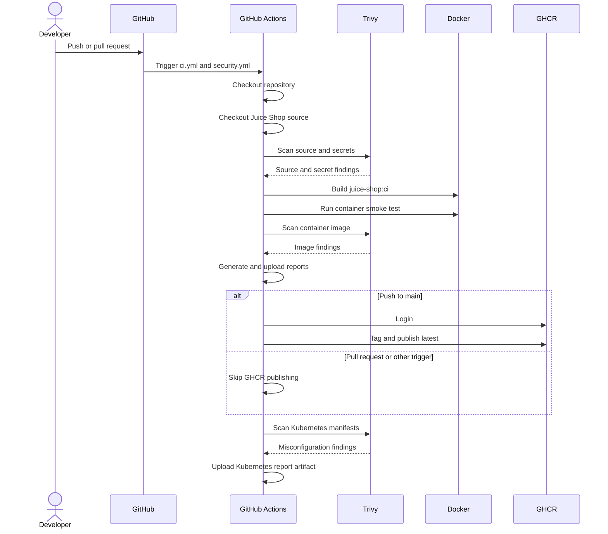
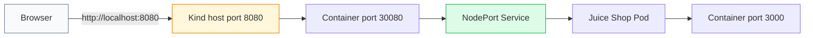
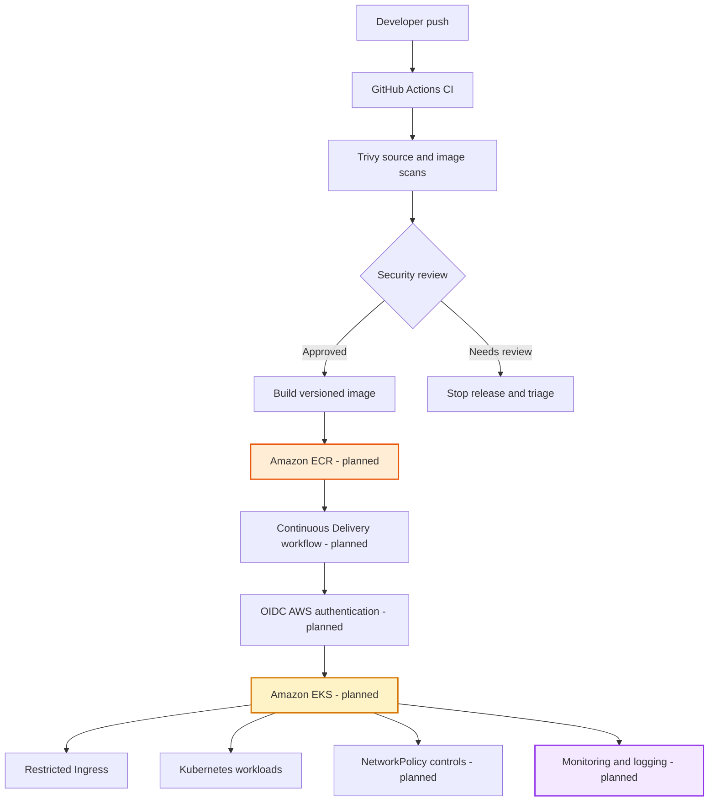

# Secure DevSecOps Pipeline on AWS

<!-- README title: update repository-specific metadata if the project location or badges change. -->

[](.github/workflows)
[](https://www.docker.com/)
[](https://kind.sigs.k8s.io/)
[](https://trivy.dev/)
[](https://aws.amazon.com/)

**A hands-on cybersecurity and DevSecOps learning project that combines automated security scanning, Docker image analysis, Kubernetes deployment, and phased AWS cloud deployment planning.**

OWASP Juice Shop—the intentionally vulnerable application—is used in an isolated learning environment to demonstrate how security findings move through source analysis, container hardening, deployment triage, and future cloud remediation.

> [!WARNING]
> OWASP Juice Shop contains intentional vulnerabilities. Run it only in a controlled, local environment and do not expose it to the public internet.

## Project Status

| Area | Status | What is implemented |
| --- | --- | --- |
| GitHub Actions CI | ✅ Implemented | `.github/workflows/ci.yml` and `.github/workflows/security.yml` are present |
| Source and filesystem scanning | ✅ Implemented | Trivy scans configuration and source files |
| Container build and image scanning | ✅ Implemented | The Juice Shop Docker image is built, smoke-tested, and scanned with Trivy |
| GHCR publishing | ✅ Implemented | The image is published by the security workflow on pushes to `main` |
| Kubernetes manifests | ✅ Implemented | Namespace, Deployment, NodePort Service, and ServiceAccount manifests are present |
| Local Kind deployment | ✅ Implemented | The application is deployed locally with NodePort access |
| Kubernetes manifest scanning | ✅ Implemented | Trivy scans manifest misconfigurations and uploads a JSON report |
| Terraform AWS EC2 deployment | 🟡 Partially present | Terraform resources for EC2 deployment exist, but an EKS deployment is not implemented |
| AWS EKS, ECR, and automated CD | ⏳ Planned | No EKS cluster, ECR pipeline, or automated EKS CD is currently implemented |
| Runtime monitoring and persistent cloud storage | ⏳ Future work | These capabilities are not configured in the repository |

**Current milestone:** local CI/CD security automation, container scanning, and local Kubernetes deployment.

**Next milestone:** review and provision AWS infrastructure, then implement ECR and Amazon EKS integration with a secure delivery workflow.

---

## Table of Contents

- [Project Goals](#project-goals)
- [Technology Stack](#technology-stack)
- [Current Architecture](#current-architecture)
- [CI and Security Pipeline](#ci-and-security-pipeline)
- [Container and Image Security](#container-and-image-security)
- [Kubernetes Deployment](#kubernetes-deployment)
- [Security Findings](#security-findings)
- [Local Deployment](#local-deployment)
- [AWS Roadmap](#aws-roadmap)
- [Repository Structure](#repository-structure)
- [Future Enhancements](#future-enhancements)
- [Learning Outcomes](#learning-outcomes)
- [References](#references)

---

## Project Goals

This project demonstrates security throughout the software delivery lifecycle:

1. Retrieve application source code and inspect it for security issues.
2. Scan source files and dependencies with Trivy.
3. Build and scan the application container image.
4. Publish approved images to GHCR from the main branch workflow.
5. Scan Kubernetes manifests for misconfiguration findings.
6. Deploy the application to a local Kind cluster.
7. Triage findings by runtime impact rather than suppressing results blindly.
8. Plan a staged AWS extension using cost-conscious architecture review.

---

## Technology Stack

| Area | Technology | Status |
| --- | --- | --- |
| Application | OWASP Juice Shop | ✅ Used |
| Source control | Git and GitHub | ✅ Used |
| CI automation | GitHub Actions | ✅ Used |
| Security analysis | Trivy | ✅ Used |
| Containerization | Docker | ✅ Used |
| Container registry | GitHub Container Registry (GHCR) | ✅ Used |
| Orchestration | Kubernetes and Kind | ✅ Used locally |
| Infrastructure | Terraform | 🟡 EC2 resources present; EKS infrastructure not implemented |
| Cloud platform | AWS | 🟡 EC2 implementation exists; EKS planned |
| Planned registry | Amazon ECR | ⏳ Planned |
| Planned delivery | GitHub Actions to Amazon EKS | ⏳ Planned |

---

## Current Architecture

> **Scope:** this diagram represents work verified in the repository and local environment. It does not include AWS EKS or automated cloud delivery.

```mermaid
flowchart LR
    A[Developer push or pull request] --> B[GitHub Repository]

    subgraph GHA[GitHub Actions: implemented]
        B --> C[CI workflow<br/>repository checks]
        B --> D[Security workflow]

        D --> E[Checkout Juice Shop source]
        E --> F[Trivy filesystem and secret scan]
        F --> G[Dependency analysis and review]
        G --> H[Build Docker image]
        H --> I[Container smoke test]
        I --> J[Trivy image scan]
        J --> K[Upload JSON reports]

        D --> L[Trivy Kubernetes scan]
        L --> M[Upload Kubernetes report]
    end

    J -->|main branch only| N[GHCR<br/>latest image]
    N --> O[Local Kind cluster]

    subgraph KIND[Kind: implemented locally]
        O --> P[devsecops namespace]
        P --> Q[Juice Shop Deployment]
        Q --> R[Juice Shop Pod]
        R --> S[NodePort Service 30080]
    end

    S --> T[localhost port 8080]

    style GHA fill:#EAF2FF,stroke:#2563EB,stroke-width:2px
    style KIND fill:#FFF7DB,stroke:#D97706,stroke-width:2px
    style N fill:#DCFCE7,stroke:#16A34A,stroke-width:2px
```



### Implemented workflow summary

- Pushes and pull requests trigger separate basic CI and security workflows.
- The security workflow retrieves Juice Shop 20.3.0 and performs filesystem, secret, dependency, image, and Kubernetes scanning.
- The container image is smoke-tested before GHCR publishing.
- Security scans use `exit-code: '0'`, so findings are reported and triaged rather than configured as automatic blocking gates.
- JSON reports are uploaded as GitHub Actions artifacts with a 14-day retention setting.
- GHCR login, tagging, and publishing occur only for a push to `main`, not for pull requests.

---

## CI and Security Pipeline

The repository currently contains two workflows:

| Workflow | File | Trigger | Purpose |
| --- | --- | --- | --- |
| Basic CI | [.github/workflows/ci.yml](.github/workflows/ci.yml) | Push or pull request to `main` | Verifies that the workflow directory exists and performs a basic repository check |
| DevSecOps Security | [.github/workflows/security.yml](.github/workflows/security.yml) | Push, pull request, or manual dispatch | Performs source, dependency, container, smoke-test, and Kubernetes checks |

### Security workflow sequence



Trivy is used to identify, but not automatically block, findings during the current learning and triage phase. Severity-based policy enforcement remains a future enhancement.

---

## Container and Image Security

The workflow builds `juice-shop:ci`, runs a container smoke test, and scans the image with Trivy.

The container check includes:

- Filesystem and secret analysis
- Dependency review
- Docker image vulnerability and misconfiguration analysis
- A temporary-container HTTP availability test
- Registration and login endpoint smoke tests
- Inspection of vulnerable package chains
- JSON reports and workflow artifacts

The image is published to:

```text
ghcr.io/preethamnn/secure-devsecops-aws:latest
```

### Security findings are triaged with context

Not every finding is a confirmed runtime risk. Triage considers:

- Whether the file participates in the deployed runtime
- Whether a vulnerability is reachable in this deployment
- Whether the result comes from an intentionally vulnerable challenge or test fixture
- Whether remediation would preserve application behavior
- Whether an upstream or dependency finding has a safe upgrade path

---

## Kubernetes Deployment

The local environment uses a Kind cluster named `devsecops-cluster` and a `devsecops` namespace.

| Configuration | Value |
| --- | --- |
| Deployment | `juice-shop` |
| Namespace | `devsecops` |
| Service | `juice-shop-service` |
| Service type | `NodePort` |
| Container port | `3000` |
| NodePort | `30080` |
| Kind host mapping | `localhost:8080` → container port `30080` |
| Image | `ghcr.io/preethamnn/secure-devsecops-aws:latest` |

### Kubernetes manifests

| File | Resource |
| --- | --- |
| [kubernetes/namespace.yaml](kubernetes/namespace.yaml) | `devsecops` Namespace |
| [kubernetes/deployment.yaml](kubernetes/deployment.yaml) | Juice Shop Deployment |
| [kubernetes/service.yaml](kubernetes/service.yaml) | NodePort Service |
| [kubernetes/serviceaccount.yaml](kubernetes/serviceaccount.yaml) | Dedicated ServiceAccount |
| [kubernetes/kind-config.yaml](kubernetes/kind-config.yaml) | Local Kind cluster port mapping |

### Implemented workload controls

| Control | Configuration |
| --- | --- |
| Non-root execution | `runAsUser: 65532` |
| Pod-level non-root setting | `runAsNonRoot: true` |
| Privilege escalation | `allowPrivilegeEscalation: false` |
| Linux capabilities | All dropped |
| Seccomp | `RuntimeDefault` |
| ServiceAccount tokens | Automatic mounting disabled |
| Dedicated ServiceAccount | `juice-shop-sa` |
| Resource requests | CPU `100m`, memory `256Mi` |
| Resource limits | CPU `500m`, memory `768Mi` |
| Startup probe | HTTP `/`, port `3000` |
| Readiness probe | HTTP `/`, port `3000` |
| Liveness probe | HTTP `/`, port `3000` |

A read-only root filesystem is **not** enabled. NetworkPolicies are not present and are therefore **not enforced** in the current Kind environment.

### Local access flow



---

## Security Findings

Trivy Kubernetes manifest scanning is configured to report HIGH and CRITICAL misconfigurations and upload `trivy-k8s-report.json` as an artifact.

| Finding | Severity | Status | Security review |
| --- | --- | --- | --- |
| `KSV-0014`: root filesystem is not read-only | HIGH | ⚠️ Remediation pending | Juice Shop requires writable storage for SQLite database creation and FTP/file operations |
| NetworkPolicy coverage | — | ⏳ Planned | No enforcing NetworkPolicy resource is currently present |
| Severity policy enforcement | — | ⏳ Future enhancement | Current scans return success to support reporting and triage |
| SBOM and provenance | — | ⏳ Future enhancement | No signing or SBOM workflow is currently implemented |

### Read-only root filesystem decision

The read-only-root-filesystem remediation was investigated locally, but the current stable Deployment does not enable it. A remediated configuration will require appropriate writable volumes for application dependencies such as SQLite and FTP storage while preserving a read-only container root filesystem.

**KSV-0014 remains outstanding.** It is documented rather than marked as fixed.

### Scan coverage

| Scan type | Target | Current purpose |
| --- | --- | --- |
| Filesystem / secret scan | Juice Shop source | Detect source, configuration, and secret findings |
| Dependency inspection | JavaScript package metadata | Review dependency chains and remediation options |
| Container image scan | `juice-shop:ci` | Identify vulnerable packages and image misconfigurations |
| Kubernetes misconfiguration scan | `kubernetes/` | Report manifest-level misconfigurations |

---

## Local Deployment

### Prerequisites

- Docker Desktop
- Git
- `kubectl`
- Kind
- Access to this repository and GHCR

### Create the local cluster

```bash
kind create cluster --name devsecops-cluster --config kubernetes/kind-config.yaml
```

### Apply Kubernetes resources

```bash
kubectl apply -f kubernetes/namespace.yaml
kubectl apply -f kubernetes/serviceaccount.yaml
kubectl apply -f kubernetes/deployment.yaml
kubectl apply -f kubernetes/service.yaml
```

### Verify the deployment

```bash
kubectl config current-context
kubectl cluster-info
kubectl get deployments -n devsecops
kubectl get pods -n devsecops
kubectl get services -n devsecops
```

Open `http://localhost:8080`.

> Keep this intentionally vulnerable application inside the local environment. Do not expose NodePort or port forwarding to the public internet.

---

## AWS Roadmap

> [!NOTE]
> The roadmap below is planned work. AWS EKS, Amazon ECR, GitHub OIDC-to-AWS authentication, automated EKS deployment, runtime monitoring, and persistent cloud storage are not currently implemented.

The repository also contains Terraform for an EC2-based deployment. It uses a default VPC/subnet, restricted security-group inputs, an EC2 IAM role with Systems Manager access, an encrypted root volume, and a Docker bootstrap script. It should not be interpreted as EKS infrastructure.



### Planned phases

| Phase | Status | Scope |
| --- | --- | --- |
| AWS architecture and cost review | ⏳ Pending | Review region, networking, IAM, cost, and operational requirements |
| Infrastructure as Code | 🟡 EC2 started; EKS pending | Expand Terraform only after architecture and security review |
| Amazon ECR integration | ⏳ Planned | Push and govern approved, versioned images |
| Amazon EKS deployment | ⏳ Planned | Deploy workloads with least-privilege configuration |
| Automated Continuous Delivery | ⏳ Planned | Add OIDC authentication and deployment validation |
| Read-only filesystem remediation | ⏳ Pending | Add appropriate writable volumes and re-run KSV-0014 review |
| NetworkPolicy enforcement | ⏳ Planned | Require a policy-enforcing CNI |
| Cloud monitoring | ⏳ Planned | Evaluate AWS and Kubernetes-native logs and metrics |

### AWS deployment architecture decision areas

- Select a target region and estimate infrastructure cost.
- Define public and private subnet boundaries.
- Apply least-privilege IAM roles and workload identities.
- Design ECR publishing and image-promotion rules.
- Restrict public application access with controlled ingress.
- Plan persistent storage explicitly for Juice Shop if needed.
- Add deployment validation and rollback procedures.

---

## Repository Structure

```text
secure-devsecops-aws/
├── .github/
│   └── workflows/
│       ├── ci.yml
│       └── security.yml
├── kubernetes/
│   ├── deployment.yaml
│   ├── kind-config.yaml
│   ├── namespace.yaml
│   ├── service.yaml
│   └── serviceaccount.yaml
├── terraform/
│   ├── .terraform.lock.hcl
│   ├── main.tf
│   └── variables.tf
├── .gitignore
└── README.md
```

The structure above reflects the repository files verified before this README update.

---

## Future Enhancements

These items are proposed work and are not represented as implemented features:

- Enforce vulnerability and policy gates in CI
- Generate and attest Software Bills of Materials (SBOMs)
- Sign container images and verify provenance
- Implement ECR promotion and EKS deployment
- Use GitHub Actions OIDC for short-lived AWS credentials
- Configure validating and mutating admission controls
- Enable and test NetworkPolicies with an enforcing CNI
- Add Kubernetes runtime security monitoring
- Centralize security logs and cloud-native observability
- Implement deployment verification and rollback automation
- Design safe persistent storage for writable application data

---

## Learning Outcomes

This project provides practical experience with:

- Integrating Trivy into GitHub Actions
- Separating CI checks from security reporting
- Building and scanning Docker images
- Triage of source, dependency, and container findings
- Publishing container images to GHCR
- Applying workload security controls in Kubernetes
- Using Kind for a local Kubernetes environment
- Investigating real storage dependencies behind a security finding
- Reviewing EC2 Terraform infrastructure requirements
- Planning a staged AWS EKS architecture
- Distinguishing implemented, in-progress, and planned capabilities

---

## References

- [OWASP Juice Shop](https://github.com/juice-shop/juice-shop)
- [Trivy Documentation](https://trivy.dev/)
- [GitHub Actions Documentation](https://docs.github.com/en/actions)
- [Docker Documentation](https://docs.docker.com/)
- [Kubernetes Documentation](https://kubernetes.io/docs/)
- [Kind Documentation](https://kind.sigs.k8s.io/)
- [Amazon EKS Documentation](https://docs.aws.amazon.com/eks/)
- [Amazon ECR Documentation](https://docs.aws.amazon.com/ecr/)
- [Terraform AWS Provider](https://registry.terraform.io/providers/hashicorp/aws/latest/docs)

---

**Author:** [Preetham Gowda](https://github.com/Preethamnn)

**Repository:** [Preethamnn/secure-devsecops-aws](https://github.com/Preethamnn/secure-devsecops-aws)
